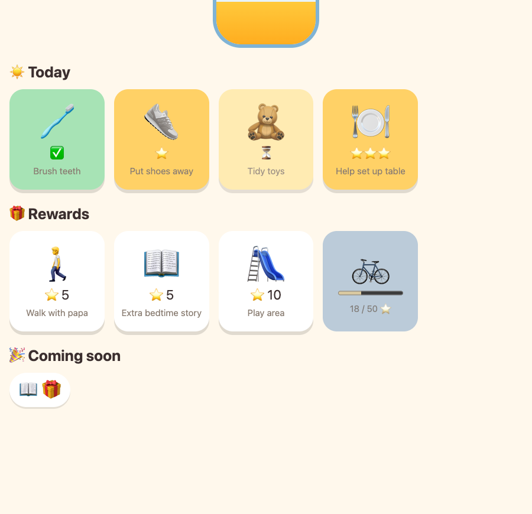
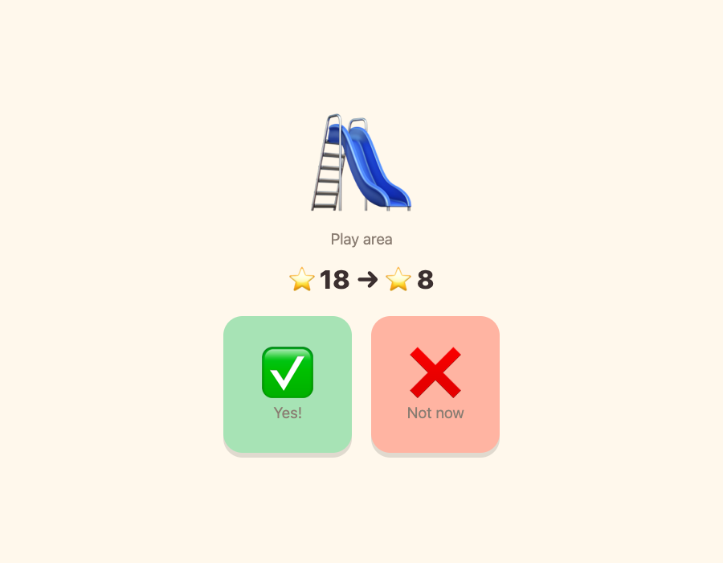
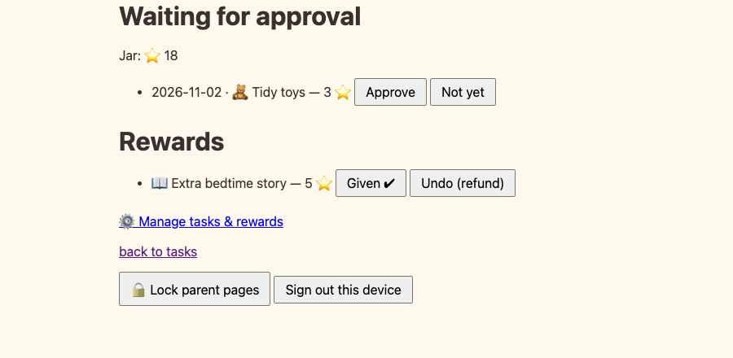
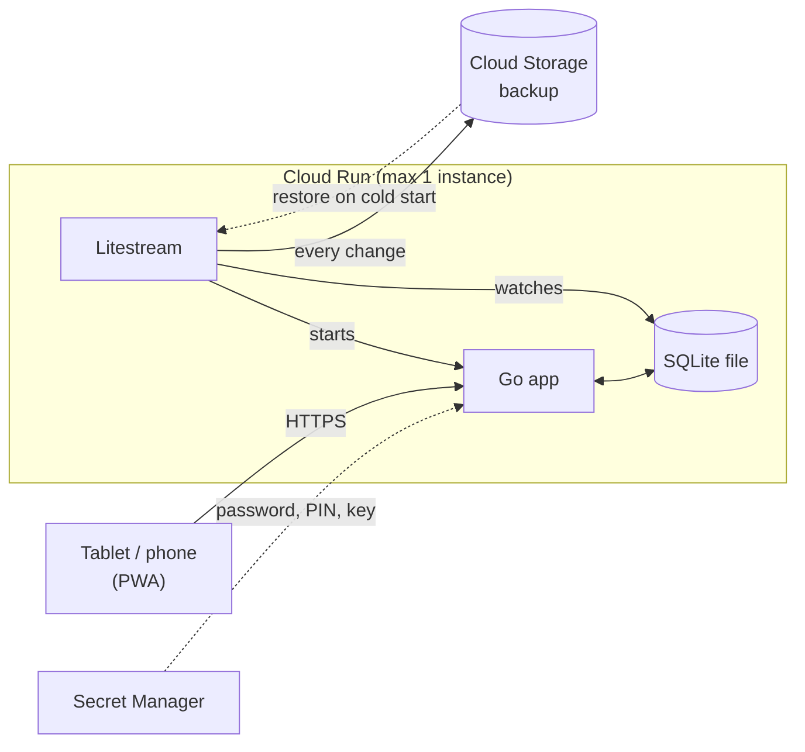

# star-jar ⭐

A small web app that helps a 4-year-old learn that effort earns rewards, and that saving
is a choice. Your child taps a task when it's done, a parent approves, and the stars fill
a jar. The jar pays for rewards: a walk with a parent now, or save up for a bike.

It runs on a tablet as an installable app, needs no reading (pictures, big buttons, sounds),
and costs about nothing to host.

<p>
  
  
</p>

## Why

A child learns best from things they can see and touch. Stars dropping into a jar make
"earning" and "spending" concrete, and the jar emptying when you buy something makes the
trade-off real. One rule shapes the app: **small things the child decides, big things we
decide together.** Small rewards are bought straight away (after an "are you sure?"),
big ones need a parent's yes.

## Features

**For the child**
- Today's tasks as big picture tiles. Stars are shown as ⭐⭐⭐, so no reading is needed.
- Tiles change colour: to do, ⏳ waiting for a parent, ✅ done, and coral when a parent said "not yet".
- A jar that fills toward the biggest reward, with falling stars and a chime when stars arrive.
- Rewards light up when affordable; the others show progress (`18 / 50 ⭐`).
- Tapping a reward asks first: picture, `⭐ 25 → ⭐ 15`, ✅ / ❌.
- Tasks reset every day at midnight in your time zone.
- Installs to the home screen (PWA), with a friendly offline page.

**For parents** (behind a PIN)
- Approve or reject finished tasks; approve or refuse big rewards.
- Undo any reward that hasn't been given yet, with a refund.
- Add, edit and hide tasks and rewards (emoji, name, stars or price, small or big).
- Updates live: approvals on your phone show up on the tablet within seconds.



## How it's built



- **Go standard library only** for the web part: `net/http` routing, `html/template`,
  `embed` (templates, CSS and JS are built into one binary).
- **HTMX** (vendored, no build step) for taps without page reloads and the 5-second live refresh.
- **SQLite** through [`modernc.org/sqlite`](https://pkg.go.dev/modernc.org/sqlite), a pure-Go
  driver, so the binary is static and the image is distroless.
- **[Litestream](https://litestream.io)** copies every change to Cloud Storage within a second
  and restores the database when Cloud Run starts a fresh instance. That's what lets a
  SQLite app scale to zero.
- **Terraform** for all infrastructure; **GitHub Actions** for CI/CD, signing in to GCP
  with **Workload Identity Federation** (no stored keys).

### Design decisions worth a look

| Decision | Why |
|---|---|
| **A ledger instead of a balance column** | Every star in or out is a row; the balance is `SUM(delta)`. Nothing is overwritten, history is free, and spending is just a negative row. |
| **Snapshot values at the time of the event** | Stars earned and the price paid are copied into the ledger and the purchase. Changing a reward's price later can't change a refund. |
| **Check and spend in one write transaction** | `_txlock=immediate` takes the write lock up front, so two quick taps can't both spend the same stars. |
| **Daily reset without a cron job** | "Done" is stored per day; a new day simply has no rows yet. |
| **Hide instead of delete** | Tasks and rewards are soft-deleted, so history keeps pointing at them. |
| **Migrations with `PRAGMA user_version`** | Numbered `.sql` files, each applied once in a transaction with the version bump. |
| **Signed cookies, no session table** | HMAC-signed `expiry.signature` cookies: a family cookie for the device (1 year) and a parent cookie after the PIN (15 minutes). Constant-time comparisons and a lockout after 5 wrong tries. |
| **One instance per family** | Families never share a database. A friend's family is one more entry in Terraform, not a multi-tenant rewrite. |
| **CI owns the image, Terraform owns the rest** | Cloud Run ignores image changes in Terraform, so `terraform apply` never rolls back a deploy. |

## Run it locally

Needs Go 1.27+.

```sh
make run
# open http://localhost:8080 — family password: family, parent PIN: 1234
```

The database is a local `star-jar.db` file, created with starter tasks and rewards on first run.

```sh
go test ./...                   # tests
docker build -t star-jar .      # the production image (Litestream + app)
```

## Configuration

| Variable | Required | Meaning |
|---|---|---|
| `FAMILY_PASSWORD` | yes | Signs a device in (once per device) |
| `PARENT_PIN` | yes | Unlocks the parent pages for 15 minutes |
| `SESSION_KEY` | recommended | 64 hex characters (`openssl rand -hex 32`). Without it a random key is used and every device is signed out on restart. Change it to sign out all devices. |
| `DB_PATH` | no | SQLite file, default `star-jar.db` (`/data/star-jar.db` in the image) |
| `TZ` | no | When tasks reset, e.g. `Europe/Berlin` (the image's default) |
| `PORT` | no | Default `8080` |
| `REPLICA_URL` | in the image | Litestream backup target, e.g. `gs://bucket/path` or `file:///backup` for testing. If it's missing, Litestream stops with "file replica path required". |

The app refuses to start without a password and PIN, so a config mistake can never put an
unprotected app online.

## Deploy your own (Google Cloud)

Everything is in [`infra/`](infra): a root configuration and a reusable `modules/family`.
Expected cost for one family: €0 to a few cents a month (Cloud Run scales to zero; the
database backup is a few hundred KB).

1. **Project and state bucket**: create a GCP project with billing, then a versioned bucket
   for Terraform state and set it in `infra/versions.tf`.
2. **Settings**: in `infra/terraform.tfvars`, set `project`, `region`, `billing_account`
   and your families:
   ```hcl
   families = {
     home = {}                              # becomes the star-jar-home service
     # friends = { timezone = "Europe/Vienna" }
   }
   ```
   Also change the parts that belong to the original setup: the GitHub repository in
   `infra/ci.tf`, the project and image path in `.github/workflows/ci.yml`, and the
   `import` block for the budget in `infra/project.tf` (delete it to have Terraform create
   a new budget instead).
3. **Everything except Cloud Run first.** The app can't start until the password and PIN
   secrets have values, so create the registry, secrets, bucket and service account first:
   ```sh
   cd infra && terraform init
   F='module.family["home"]'
   terraform apply -var image_tag=initial \
     -target=google_project_service.apis -target=google_artifact_registry_repository.images \
     -target="$F.google_service_account.app" -target="$F.google_storage_bucket.db" \
     -target="$F.google_storage_bucket_iam_member.app" -target="$F.google_secret_manager_secret.app" \
     -target="$F.google_secret_manager_secret_iam_member.app" -target="$F.google_secret_manager_secret_version.session_key"
   ```
4. **Password and PIN** (typed, never stored in files or shell history):
   ```sh
   read -rs "P?Family password: " && printf '%s' "$P" | gcloud secrets versions add star-jar-home-family-password --data-file=- && unset P
   read -rs "P?Parent PIN: "      && printf '%s' "$P" | gcloud secrets versions add star-jar-home-parent-pin --data-file=- && unset P
   ```
   The session key is generated by Terraform as an ephemeral value and never stored in state.
5. **First image and the app**:
   ```sh
   TAG=$(git rev-parse --short HEAD)
   docker buildx build --platform linux/amd64 -t <region>-docker.pkg.dev/<project>/star-jar/star-jar:$TAG --push .
   cd infra && terraform apply -var image_tag=$TAG
   terraform output urls
   ```
6. **From now on, deploying is `git push`.** [`.github/workflows/ci.yml`](.github/workflows/ci.yml)
   runs gofmt, vet, tests and build on every push and pull request. On `main` it builds
   the image and updates every Cloud Run service labelled `app=star-jar`. Update the
   provider and service account in the workflow from `terraform output`.

Open the URL on the tablet, sign in once, and use **Add to Home Screen** (iPad) or
**Install app** (Android).

**Known limit:** during a deploy, the old and new revision run side by side for a few
seconds. A tap in exactly that moment could be lost. For a family app that's an accepted
trade-off against running a database server.

## Project history

Built step by step as a way to learn Go, with each version small enough to understand fully.

| Version | What it added |
|---|---|
| v0 | An in-memory task list and a star counter |
| v1 | SQLite, the ledger, parent approval, rewards and spending |
| v2 | The kid screen, live updates with HTMX, sounds, PWA install, the manage page and migrations |
| v3 | Production readiness (config, graceful shutdown, Docker), sign-in and PIN, Cloud Run with Litestream, Terraform |
| v3.4 | CI/CD with GitHub Actions and Workload Identity Federation |

Since then it's been in daily use, which is where real bugs come from: the "are you sure?"
screen exists because a small finger bought a reward by accident.

**Ideas for later:** a savings goal you can pick, per-task schedules (weekdays, one-off),
server-sent events instead of polling, a configurable parent name.

## License

[MIT](LICENSE)
